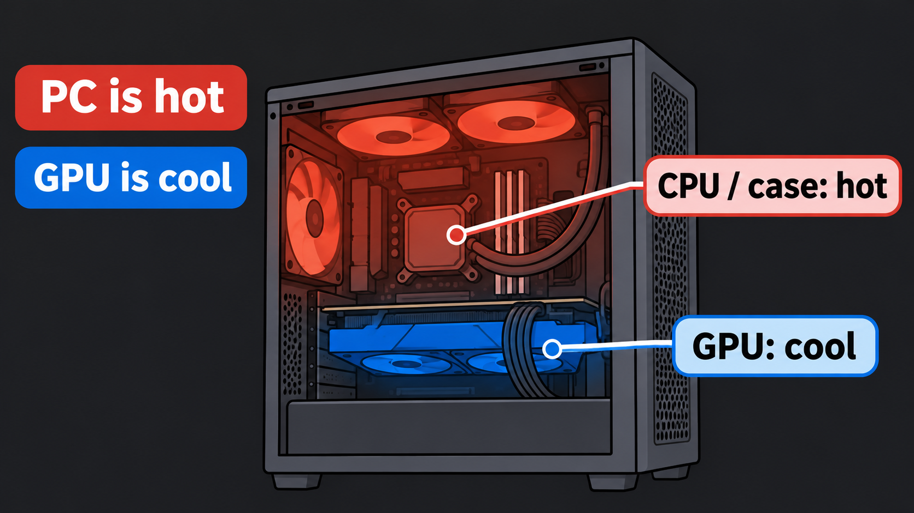

# Thermal RGB for Linux

Map Linux temperature sensors to OpenRGB devices or zones. CPU-only, GPU-only
and mixed setups use one sampling loop. Colours run from blue through cyan,
green, yellow and orange to red, with brightness and temperature endpoints per
output. This controls lighting, never cooling or fan speeds.

## Quick start

```bash
./install.sh            # first run creates your config
```

Close the OpenRGB GUI, then start only the SDK server to discover names:

```bash
openrgb --server --noautoconnect --server-host 127.0.0.1
```

In another terminal:

```bash
./manage.sh devices    # exact device and zone names
./manage.sh sensors    # available temperature readings
./manage.sh config     # replace the placeholders
```

Stop the manual server with Ctrl+C, then install and verify:

```bash
./install.sh
./manage.sh doctor
```

The installer preserves your config and enables startup at login. `doctor`
checks services, the installed app and configured device/zone names without
changing lighting. If names do not match, it shows the available names.
`--check-config` only validates the config file; it does not check hardware.

The controller samples every 60 seconds, uses 2°C hysteresis and skips unchanged
colours. Failed readings briefly retain their last value, then show red. It
controls lighting, never cooling or fan speeds. Shutdown leaves the last colour.

## Supported hardware and platforms

The controller supports Linux with Python 3.11+, psutil and an OpenRGB SDK server.
Managed services require systemd. RGB devices must support OpenRGB's **Direct**
mode; device names and zones are configured explicitly. No motherboard or GPU
model is required by the general-purpose configuration.

Temperature sources:

| Type | Selection |
| --- | --- |
| `auto_cpu` | Common k10temp, zenpower, coretemp or cpu_thermal CPU labels |
| `psutil` | Any exposed driver, optional exact label, and reading index |
| `nvidia` | NVIDIA GPU index via `nvidia-smi` |

AMD/Intel GPU temperatures can be used if exposed by psutil; choose the actual
driver/label reported on your machine. This is not universal GPU discovery.
NVIDIA tooling is unnecessary unless an active output uses a `nvidia` source.

## Install and configure

On Manjaro/Arch, as your normal user:

```bash
sudo pacman -S --needed python python-pip python-psutil openrgb
./install.sh
```

A first install creates `~/.config/thermal-rgb/config.toml` and exits without
changing services. Edit the sensor/device placeholders, then run the installer
again. The second run creates a Python environment, validates configuration and
installs/enables/starts the two user services. `XDG_CONFIG_HOME` is respected.
Other distros need Python with venv/pip support and OpenRGB installed first.

Discover local temperature sources:

```bash
python3 thermal_rgb.py --list-sensors
# After installation:
./manage.sh sensors
```

Use `./manage.sh devices` to inspect exact device and zone names from a running
SDK server. **Close the GUI before running the installer or starting the managed server.** Run only one
OpenRGB hardware controller; stop the services before using a GUI controller.
Working OpenRGB device/udev permissions are required.

The configuration has named sensor tables and an output list:

```toml
[sensors.cpu]
type = "auto_cpu"

[sensors.gpu]
type = "psutil"
driver = "amdgpu" # example only: use --list-sensors on your machine
label = "edge"
index = 0

[[outputs]]
name = "case-lighting"
sensor = "cpu"
device = "My motherboard" # replace with your OpenRGB name
zone = "Addressable 1"    # omit for whole-device lighting
blue_temp = 25.0
red_temp = 90.0
brightness = 0.40

[[outputs]]
name = "gpu-lighting"
sensor = "gpu"
device = "My GPU"         # replace with your OpenRGB name
blue_temp = 25.0
red_temp = 85.0
brightness = 1.0
```

Omit unwanted sensor/output tables. Multiple outputs can share a source without
extra sensor reads. Exact device/zone names take precedence over unique substring
matches. Missing or ambiguous matches and overlapping outputs are rejected;
whole-device lighting cannot overlap zone lighting on that same device.

For psutil sources, omitting `label` selects by index within the driver's readings.
Providing `label` filters by that exact label first; `index` then selects within
those matches. Use the listing's `driver_index` without a label, or `label_index`
with a label. The default index is zero. To use NVIDIA:

```toml
[sensors.gpu]
type = "nvidia"
index = 0
```

The default blue/red endpoints are 25/90°C and brightness is 1.0 when omitted.
The blue endpoint is a reference, not a measured room temperature. To initialize
an ARGB zone that reports zero LEDs, explicitly add `led_count = 8` (using your
actual count) to that output. No count is guessed, and non-empty zones are not
resized. Fan count does not necessarily equal LED count; respect controller limits.

See [config.example.toml](config.example.toml) for the general template and
[examples/x570-rtx3080.toml](examples/x570-rtx3080.toml) for the original ASUS PRIME
X570-P / Gigabyte RTX 3080 configuration, including its brightness and LED count.

## Manage and upgrade

```bash
./manage.sh config
./manage.sh restart
./manage.sh status
./manage.sh logs
./manage.sh doctor
./manage.sh stop
./manage.sh start
```

Rerun `./install.sh` to update. It preserves config byte for byte, replaces the
application and service files, backs up old units, and enables/starts both
services—even if previously disabled. Lighting restarts each time. A failed
service stop aborts before files are replaced.

Old `[devices]` / `[temperatures]` configs still work; no migration is required.
To switch formats, copy your settings into the new template. When `[[outputs]]`
is present, legacy device/temperature tables are ignored.

Existing explicit polling intervals remain respected. To adopt low-overhead
settings, edit the existing `[animation]` section:

```toml
sensor_interval = 60.0
report_interval = 60.0
temperature_hysteresis = 2.0
breathing = false
diagnostics = false
```

Legacy breathing, smoothing and per-device animation timing options remain
readable but have no effect. New keys receive defaults when omitted.

```bash
git pull
./install.sh
# Installer starts services; after later config edits:
./manage.sh restart
systemctl --user show thermal-rgb.service openrgb-local.service \
  -p Nice -p IOSchedulingClass -p CPUWeight -p IOWeight
```

Dependencies and config are checked before stopping services. Dependencies use
the existing Python environment; upgrades are not atomic and have no automatic
rollback. Services start at login. `./install.sh --boot` enables user lingering
with sudo; device permissions must also work before login.

The units are `thermal-rgb.service` and `openrgb-local.service`. The managed SDK
server listens on `127.0.0.1`, using `[openrgb].port` (6742 by default), and runs
as your user. After changing the port, rerun the installer to update the server unit.

## Diagnostics

`./manage.sh doctor` checks setup. Use `./manage.sh logs` to follow runtime errors.
For optional reading/write counters, set `diagnostics = true` under `[animation]`,
restart, then run `./manage.sh diagnostics`. The summary appears on the next sample.

## Remove or test

```bash
./uninstall.sh                # preserve config
./uninstall.sh --purge-config # remove config too

python3 -m unittest discover -s tests -v
python3 thermal_rgb.py --config config.example.toml --check-config
python3 thermal_rgb.py --config examples/x570-rtx3080.toml --check-config
```

Tests use mocked hardware and isolated installer commands. No OpenRGB Python
package or hardware is needed for tests. Removal leaves system packages, service
backups and lingering settings intact.

MIT license — see [LICENSE](LICENSE).
