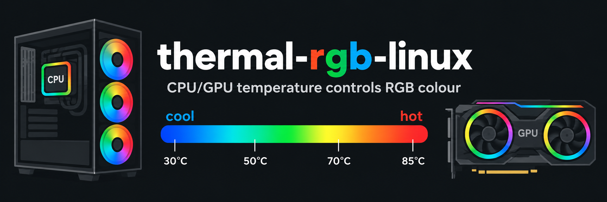

# Thermal RGB for Linux

CPU temperature controls the fan lighting; GPU temperature controls the GPU lighting.
Both use a blue → cyan → green → yellow → orange → red gradient with smooth breathing.
This controls lighting, not fan speed or thermal protection.

## Install after formatting

1. Install a working NVIDIA driver (`nvidia-smi` must work).
2. Download or clone this repository and open a terminal in its folder.
3. Run:

```bash
./install.sh
./manage.sh doctor
```

Run as your normal user. On Arch/Manjaro, the installer can install missing Python
and OpenRGB packages with pacman. On other distros, install **Python 3.11+ with
venv/pip support** and **OpenRGB with working device permissions** first.
The installer creates its own Python environment and starts two systemd user services.
Lighting starts when you log in. Optional startup before login:

```bash
./install.sh --boot
```

This enables user lingering; OpenRGB device permissions must also work before login.
See [OpenRGB udev guidance](https://openrgb.org/udev.html).

## Hardware and portability

Defaults target an **ASUS PRIME X570-P**, its **Aura Addressable 1** zone, and a
**Gigabyte RTX 3080**. Other OpenRGB-supported hardware requires editing the device
names and zone in your config. CPU sensors supported by this script are k10temp,
zenpower, coretemp and cpu_thermal. GPU temperature comes from NVIDIA's `nvidia-smi`.
AMD/Intel GPUs, Windows/macOS and Linux without systemd are not supported by this setup.

Six physical fans do not imply six addressable LEDs. The default zone size of 8
worked on the original machine's shared header. The script only resizes a zone
that reports zero LEDs. Set the correct count for your controller and respect
motherboard current limits.

## Configure and manage

```bash
./manage.sh config     # edit settings
./manage.sh restart    # apply settings
./manage.sh status
./manage.sh logs
./manage.sh doctor
./manage.sh stop
./manage.sh start
```

Config lives at `~/.config/thermal-rgb/config.toml` (or under `XDG_CONFIG_HOME`).
Installs and upgrades preserve it. Back up this file before formatting.
Defaults: fans at 40% maximum brightness, GPU at 100%, six-second breathing,
CPU red at 90°C and GPU red at 85°C. The 25°C blue point is a reference,
not a measured room temperature. See `config.example.toml` for all settings.

Sensors update independently. Failed readings are retried; after 10 seconds or
three configured sensor intervals (whichever is longer), stale readings fade
toward red. Missing readings also start red. Fresh readings restore normal colours.
Failures appear in the logs. Sensor polling runs separately so it cannot stall
animation; smoothing and breathing use elapsed time.

**Run only one OpenRGB hardware controller.** Close the OpenRGB GUI and disable
other OpenRGB autostarts/services before installation. Competing instances caused
high CPU usage and input freezes on the original machine. The installer checks for
other OpenRGB processes owned by your user and the standard `openrgb.service`.
To use the GUI, stop these services first and close the GUI before restarting them.

The managed SDK server listens on `127.0.0.1:6742` and runs as your user.
The units are `openrgb-local.service` and `thermal-rgb.service`.

## Upgrade or remove

```bash
git pull
./install.sh

./uninstall.sh                # keep config
./uninstall.sh --purge-config # remove config too
```

Removal leaves system packages, service backups and the lingering setting intact.

## Tests

With Python and psutil installed, no RGB hardware or OpenRGB Python package is needed:

```bash
python3 -m unittest discover -s tests -v
python3 thermal_rgb.py --config config.example.toml --check-config
```

The runtime dependencies are installed automatically by the installer.

MIT license — see [LICENSE](LICENSE).
